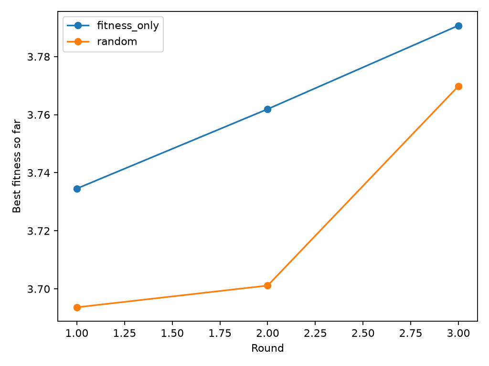

# 面向蛋白质定向进化的科学智能体

**研究任务**：基于 GFP 的公开深度突变扫描（DMS）数据，训练适应度预测器，并使用 LLM Agent 模拟“训练集证据分析 → 科学假设 → 候选设计 → 模型评分 → 评审反馈”的三轮虚拟定向进化。重点比较随机基线、MLP 直接推荐、普通 Agent、知识增强 Agent。

## 1. 环境与安装

- 使用 **Python 3.11**
- 保存模型使用 **scikit-learn 1.7.2**。
- 主要依赖：`numpy`、`pandas`、`scipy`、`scikit-learn`、`joblib`、`matplotlib`、`openai`、`biopython`、`networkx`。
- Agent 使用 **DeepSeek API Key** 与网络访问；baseline、已保存模型评估不需要调用 LLM。

创建环境：

```bash
conda create -n gfp python=3.11 -y
conda activate gfp
python -m pip install -r requirements.txt
```

**API Key 通过 `agent/config.py` 输入密钥进行使用。当前 `deepseek-flash` 是 DeepSeek 官方文档所列的模型名。

## 2. 数据来源和任务

### 2.1 数据集

| 内容 | 说明 |
|---|---|
| 目标蛋白 | *Aequorea victoria* 绿色荧光蛋白（GFP），参考序列长 **238 aa** |
| 数据文件 | `data/GFP_AEQVI_Sarkisyan_2016.csv` |
| 历史变体 | **51,714** 条；训练集 **36,199**，验证集 **7,757**，测试集 **7,758**（`seed=42`） |
| 核心字段 | `mutant`（如 `Y39N:K158R`）、`mutated_sequence`、`DMS_score`、`DMS_score_bin` |
| 数据划分 | `fitness/split.py` 使用 70%/15%/15% 的随机划分；生成的文件已附于 `data/` |

来源：Sarkisyan K. S. *et al.*, **Local fitness landscape of the green fluorescent protein**, *Nature* **533**, 397–401 (2016)，[DOI:10.1038/nature17995](https://doi.org/10.1038/nature17995)。预处理的数据字段和下载说明见 [ProteinGym 官方仓库](https://github.com/OATML-Markslab/ProteinGym)。


### 2.2 参考序列与若干代表性突变序列（FASTA）

以下参考序列通过 `agent/designer.py::infer_wild_type()` 将已知变体按 `mutant` 反推得到；

```fasta
>WT_GFP_238aa_WT_score
MSKGEELFTGVVPILVELDGDVNGHKFSVSGEGEGDATYGKLTLKFICTTGKLPVPWPTLVTTLSYGVQCFSRYPDHMK
QHDFFKSAMPEGYVQERTIFFKDDGNYKTRAEVKFEGDTLVNRIELKGIDFKEDGNILGHKLEYNYNSHNVYIMADKQK
NGIKVNFKIRHNIEDGSVQLADHYQQNTPIGDGPVLLPDNHYLSTQSALSKDPNEKRDHMVLLEFVTAAGITHGMDELY
K
>train_K158G_measured_DMS_4.1136
MSKGEELFTGVVPILVELDGDVNGHKFSVSGEGEGDATYGKLTLKFICTTGKLPVPWPTLVTTLSYGVQCFSRYPDHMK
QHDFFKSAMPEGYVQERTIFFKDDGNYKTRAEVKFEGDTLVNRIELKGIDFKEDGNILGHKLEYNYNSHNVYIMADKQG
NGIKVNFKIRHNIEDGSVQLADHYQQNTPIGDGPVLLPDNHYLSTQSALSKDPNEKRDHMVLLEFVTAAGITHGMDELY
K
>Agent_plain_R2_top1__Y39N_N105Y_K158G_L221V
MSKGEELFTGVVPILVELDGDVNGHKFSVSGEGEGDATNGKLTLKFICTTGKLPVPWPTLVTTLSYGVQCFSRYPDHMK
QHDFFKSAMPEGYVQERTIFFKDDGYYKTRAEVKFEGDTLVNRIELKGIDFKEDGNILGHKLEYNYNSHNVYIMADKQG
NGIKVNFKIRHNIEDGSVQLADHYQQNTPIGDGPVLLPDNHYLSTQSALSKDPNEKRDHMVLVEFVTAAGITHGMDELY
K
>Agent_knowledge_R3_top1__Y39N_K158R_S175T_N212K_L221V
MSKGEELFTGVVPILVELDGDVNGHKFSVSGEGEGDATNGKLTLKFICTTGKLPVPWPTLVTTLSYGVQCFSRYPDHMK
QHDFFKSAMPEGYVQERTIFFKDDGNYKTRAEVKFEGDTLVNRIELKGIDFKEDGNILGHKLEYNYNSHNVYIMADKQR
NGIKVNFKIRHNIEDGTVQLADHYQQNTPIGDGPVLLPDNHYLSTQSALSKDPKEKRDHMVLVEFVTAAGITHGMDELY
K
>Agent_graph_R3_top1__N105Y_S175T_L221V
MSKGEELFTGVVPILVELDGDVNGHKFSVSGEGEGDATYGKLTLKFICTTGKLPVPWPTLVTTLSYGVQCFSRYPDHMK
QHDFFKSAMPEGYVQERTIFFKDDGYYKTRAEVKFEGDTLVNRIELKGIDFKEDGNILGHKLEYNYNSHNVYIMADKQK
NGIKVNFKIRHNIEDGTVQLADHYQQNTPIGDGPVLLPDNHYLSTQSALSKDPNEKRDHMVLVEFVTAAGITHGMDELY
K
```


### 2.3 知识来源

| 文件或库 | 内容 | 使用方式 |
|---|---|---|
| `data/GFP_properties.xlsx`、`data/aa_props.csv` | 20 种氨基酸 × 6 种性质：`Volume`、`Charge`、`Hydropathy`、`Polarity`、`Flexibility`、`BetaSheet` | 输入给增强 Agent，比较替换后－替换前的性质变化。 |
| Biopython BLOSUM62 | 氨基酸替换的进化保守性 | `Bio.Align.substitution_matrices.load("BLOSUM62")`；[Biopython 文档](https://biopython.org/docs/latest/Tutorial/chapter_pairwise.html) |
| `train.csv` 的已测变体 | 高分单点、位点富集、多点共现 | 用于 `DataAnalyst` 和 `GraphKnowledge`，**不读取 val/test 的真实标签指导 Agent** |

## 3. 项目架构与知识增强

```text
历史 GFP DMS (train.csv) ──> DataAnalyst ──> 高分单点/位点富集/历史证据
                                                 │
                                         可选 KnowledgeBase
                                     6 种性质 + BLOSUM62 + 历史单点
                                                 │
                                        可选 GraphKnowledge
                                     训练集变体-突变-位点-观测图
                                                 │
                                                 ▼
                  DeepSeek HypothesisGenerator（读取全部已评分历史与反馈）
                                                 │  突变假设/理由/风险
                                                 ▼
                  MutationDesigner（WT 校验，1–5 位替换、去重）
                                                 │  合法候选全长序列
                                                 ▼
                  FitnessEvaluator（固定的同一个 MLP，按预测分降序）
                                                 │  Top-k + 所有候选评分
                                                 ▼
                  ScientificCritic（评审证据、风险与下一轮建议）
                                                 │
                                       更新历史 → 进入下一轮
```

- `agent/analyst.py`：按训练集前 10% 高分阈值统计富集，抽取 Top 变体和单点证据。
- `agent/generator.py` / `agent/llm.py`：通过 DeepSeek 生成可解释的突变假设（JSON，包括 `strategy`、`reason`、`risk`）。
- `agent/designer.py`：标准 20 种氨基酸、原残基匹配、索引有效、1–5 个不同突变位点、训练集/当前及历史轮次去重；无效候选被拒绝并留痕。
- `agent/evaluator.py` / `agent/predictor.py`：调用相同的 MLP 模型，统一排序取 Top-k；知识库**不直接修改分数、不改变打分权重**。
- `agent/critic.py`：从训练数据、知识证据和模型评分解释推荐，并反馈潜在失败假设。
- `agent/knowledge.py`：补充 6 种性质、BLOSUM62 和高分单点知识。
- `agent/graph.py`：仅使用训练集 **749** 条单点变体及 **3,620** 条 Top 10% 变体并集（去重后 **4,208** 条），阈值约 **3.71680**，构建 **9,781** 个节点、**46,349** 条边的 `networkx.MultiDiGraph`。常用关系包括 `Mutation → occurs_at → Position`、`Variant → contains → Mutation`、`Variant → has_fitness → FitnessObservation`。**高分共现不等于单点因果增益**。

### 项目文件树

```text
DMS/
├── main.py                     # 训练好的 MLP + Random/MLP 对照 + 3 种 Agent
├── requirements.txt
├── agent/
│   ├── config.py               # 读取 API Key
│   ├── analyst.py              # 统计历史数据
│   ├── generator.py            # LLM 突变假设
│   ├── designer.py             # 产生和校验候选序列
│   ├── evaluator.py            # 评分与 Top-k
│   ├── predictor.py            # MLP 适配
│   ├── critic.py               # 科学评审
│   ├── knowledge.py            # 理化性质与 BLOSUM62
│   ├── graph.py                # 训练集知识图谱
│   └── llm.py                  # DeepSeek 访问
├── fitness/
│   ├── split.py                # 划分数据
│   ├── train.py                # 训练/评估 MLP
│   └── fitness_mlp.joblib      # 已保存模型
├── data/
│   ├── GFP_AEQVI_Sarkisyan_2016.csv
│   ├── train.csv / val.csv / test.csv
│   ├── GFP_properties.xlsx
│   └── aa_props.csv
├── results/
│   ├── mlp_metrics.csv
│   ├── baselines.csv
│   ├── fitness_curve.png
│   ├── agent_prediction_curve.png
│   ├── agent_plain/rounds.csv, candidates.csv
│   ├── agent_knowledge/rounds.csv, candidates.csv
│   └── agent_graph/rounds.csv, candidates.csv
└── 模块说明.md
```

## 4. 复现实验：运行命令

从根目录调用下面的命令；

```bash
# (A) 在 train/val/test 上评估已保存的 MLP
python -m fitness.train

# (B) 测试集上的 Random / MLP 直接推荐，产生 baselines.csv 和 fitness_curve.png
python main.py --mode baseline --rounds 3 --n 20 --top-k 5

# (C) 无知识增强的 LLM Agent
python main.py --mode agent --rounds 3 --n 20 --top-k 5

# (D) 理化性质 + BLOSUM62 + 历史高分单点
python main.py --mode agent --knowledge --rounds 3 --n 20 --top-k 5

# (E) 知识图谱增强
python main.py --mode agent --graph --rounds 3 --n 30 --top-k 5
```


**命令参数**：`--rounds` 为轮次（此项目结果为 3），`--n` 是每轮请求的有效候选预算，`--top-k` 是每轮最终推荐数（这里为 5）。`--knowledge`、`--graph` 互斥且只用于 Agent 模式。

**输出位置**：`results/mlp_metrics.csv`、`results/baselines.csv`、`results/fitness_curve.png`，以及三种 Agent 各自的 `results/agent_*/rounds.csv` 和 `results/agent_*/candidates.csv`。其中 `candidates.csv` 保留全部已评分与拒绝的候选，可通过 `in_top_k == True` 筛选排名前 5；`status=rejected` 的候选没有预测值。`rounds.csv` 含有效、拒绝、当轮最优、累计最优和下一轮反馈。

复现相同流程不保证得到**完全相同的 LLM 提案**：输出受模型版本、采样和服务端行为影响。

## 5. 主要结果与完整 Top-5

### 5.1 MLP 适应度预测模型

特征为固定 238 aa 序列的位点级 One-Hot 编码；模型为 `MLPRegressor(hidden_layer_sizes=(128,64), alpha=0.01, batch_size=256, max_iter=80, early_stopping=True, random_state=42)`。Top 5% 命中率是在各划分内部，预测分数前 5% 与真实 DMS_score 前 5% 的样本重合率。

| 数据集 | MSE ↓ | Pearson ↑ | Spearman ↑ | R² ↑ | Top 5% 命中率 ↑ |
|---|---:|---:|---:|---:|---:|
| train | 0.0388 | 0.9831 | 0.8954 | 0.9654 | 40.00% |
| val | 0.0637 | 0.9716 | 0.8746 | 0.9432 | 38.14% |
| test | 0.0600 | 0.9731 | 0.8750 | 0.9462 | 35.31% |

测试集 Pearson = **0.9731**，Spearman = **0.8750**，MSE = **0.0600**，前 5% 命中率为 **35.31%**。

### 5.2 Random vs. 预测器直接排序

每轮在同一组 **30** 个测试集变体构成的候选池中取 5 个：Random 随机取样，`fitness_only` 按 MLP 预测排序取 Top-5，然后使用**测试集中隐藏的实验 DMS_score**评价。

| 方法 | 第 1 轮 mean / best | 第 2 轮 mean / best | 第 3 轮 mean / best | 累计最佳（第 3 轮） |
|---|---:|---:|---:|---:|
| `random` | 2.9033 / 3.6936 | 2.3132 / 3.7011 | 1.8570 / 3.7699 | 3.7699 |
| `fitness_only` | 3.6501 / 3.7345 | 3.6764 / 3.7619 | 3.6917 / 3.7907 | 3.7907 |



### 5.3 三类 Agent 的预测适应度变化

本表使用**该轮 MLP 预测分数**作为评估指标。

| 模式 | 第 1 轮 best / Top-5 均值 | 第 2 轮 best / Top-5 均值 | 第 3 轮 best / Top-5 均值 | 第 3 轮累计最佳 |
|---|---:|---:|---:|---:|
| 普通 LLM Agent | 3.9813 / 3.9201 | 4.1124 / 4.0367 | 4.0959 / 4.0376 | 4.1124 |
| 通用知识增强 Agent | 4.0055 / 3.9565 | 4.1320 / 4.0551 | 4.1946 / 4.1238 | 4.1946 |
| 知识图谱增强 Agent | 3.9881 / 3.9510 | 4.0321 / 3.9868 | 4.0959 / 4.0244 | 4.0959 |


- 普通 Agent：当轮最优 **3.9813 → 4.1124 → 4.0959**。第 3 轮低于第 2 轮，**不是逐轮严格提升**；累计最佳仍为 4.1124。
- 通用知识增强：**4.0055 → 4.1320 → 4.1946**，三轮预测最优持续升高；第 3 轮比第 1 轮高 **0.1891**。
- 图谱增强：**3.9881 → 4.0321 → 4.0959**，三轮预测最优持续升高；第 3 轮比第 1 轮高 **0.1078**。
- **本次运行中**，通用知识增强的最终预测最优高于图谱增强；

### 5.4 全部三轮推荐 Top-5

#### A. 普通 LLM Agent（`--mode agent`）

| 轮次 | 排名 | 突变组合| MLP 预测 DMS_score |
|:---:|:---:|---|---:|
| 1 | 1 | `K158G:N212K:L221V` | 3.9813 |
| 1 | 2 | `N212K:L221V` | 3.9452 |
| 1 | 3 | `K158G:L221V` | 3.9188 |
| 1 | 4 | `Y39N:T62A:K158G` | 3.8806 |
| 1 | 5 | `K158G:S175T` | 3.8745 |
| 2 | 1 | `Y39N:N105Y:K158G:L221V` | 4.1124 |
| 2 | 2 | `Y39N:K158G:N212K:L221V` | 4.0614 |
| 2 | 3 | `N105Y:K158G:L221V` | 4.0323 |
| 2 | 4 | `K158G:Q184L:N212K:L221V` | 3.9965 |
| 2 | 5 | `Y39N:S175T:N212K` | 3.9810 |
| 3 | 1 | `N105Y:S175T:L221V` | 4.0959 |
| 3 | 2 | `Y39N:T62A:K158G:N212K:L221V` | 4.0871 |
| 3 | 3 | `Y39N:N105Y:S175T` | 4.0321 |
| 3 | 4 | `K158G:S175T:L221V` | 4.0184 |
| 3 | 5 | `Y39N:K158G:S175T` | 3.9546 |

#### B. 通用知识增强 Agent（`--knowledge`）

| 轮次 | 排名 | 突变组合| MLP 预测 DMS_score |
|:---:|:---:|---|---:|
| 1 | 1 | `S30Y:N212K:L221V` | 4.0055 |
| 1 | 2 | `S175T:L221V` | 3.9823 |
| 1 | 3 | `Y39N:N105Y:Q184K` | 3.9520 |
| 1 | 4 | `Y39N:N105Y` | 3.9324 |
| 1 | 5 | `S30C:K158G:S175T` | 3.9103 |
| 2 | 1 | `Y39N:K158R:S175T:L221V` | 4.1320 |
| 2 | 2 | `K158R:S175T:L221V` | 4.0519 |
| 2 | 3 | `S175T:N212K:L221V` | 4.0448 |
| 2 | 4 | `Y39N:N105Y:S175T` | 4.0321 |
| 2 | 5 | `K158R:N212K:L221V` | 4.0147 |
| 3 | 1 | `Y39N:K158R:S175T:N212K:L221V` | 4.1946 |
| 3 | 2 | `S30Y:Y39N:S175T:N212K:L221V` | 4.1853 |
| 3 | 3 | `K158R:S175T:N212K:L221V` | 4.1144 |
| 3 | 4 | `N105Y:N144G:S175T:L221V` | 4.1062 |
| 3 | 5 | `K158G:S175T:L221V` | 4.0184 |

#### C. 知识图谱增强 Agent（`--graph`）

| 轮次 | 排名 | 突变组合| MLP 预测 DMS_score |
|:---:|:---:|---|---:|
| 1 | 1 | `N105Y:K158G:S175T` | 3.9881 |
| 1 | 2 | `Y39N:N105Y:A110S:S175T` | 3.9859 |
| 1 | 3 | `R73L:N105Y:A110S:K158G:S175T` | 3.9573 |
| 1 | 4 | `Y39N:N105Y` | 3.9324 |
| 1 | 5 | `Y39S:N105Y:K158G` | 3.8917 |
| 2 | 1 | `Y39N:N105Y:S175T` | 4.0321 |
| 2 | 2 | `K158G:S175T:L221V` | 4.0184 |
| 2 | 3 | `Y39N:Q80H:N105Y` | 3.9737 |
| 2 | 4 | `Y39N:T62A:N105Y` | 3.9581 |
| 2 | 5 | `N105Y:S175T` | 3.9519 |
| 3 | 1 | `N105Y:S175T:L221V` | 4.0959 |
| 3 | 2 | `Y39N:N105Y:K158G:S175T` | 4.0682 |
| 3 | 3 | `Q80H:N105Y:L221V` | 4.0375 |
| 3 | 4 | `Y39N:N105Y:K158G` | 3.9685 |
| 3 | 5 | `Y39N:N105Y:Q184K` | 3.9520 |

### 5.5 合法候选与拒绝统计

本表中的拒绝表示候选**违反规则或重复**；部分轮次生成请求超出一次预算是因为系统自动补充候选。

| 模式 | R1 有效 / 拒绝 | R2 有效 / 拒绝 | R3 有效 / 拒绝 |
|---|---:|---:|---:|
| 普通 LLM Agent | 18 / 31 | 20 / 1 | 20 / 10 |
| 通用知识增强 Agent | 19 / 19 | 18 / 8 | 20 / 5 |
| 知识图谱增强 Agent | 20 / 21 | 18 / 21 | 20 / 21 |

普通 Agent 三轮拒绝合计 **42** 条（重复 34、非法 8）；通用知识 Agent **32** 条（重复 30、非法 2）；图谱 Agent **63** 条（均为重复）。图谱增强在本次输出中明显存在重复历史高分组合的倾向，需要更强的多样性约束与去重反馈。

## 6. Agent 推理轨迹与失败案例

下文按照 `DataAnalyst` 提供的统计证据、`candidates.csv` 的 `reason/risk/assessment/critic_risk` 和 `rounds.csv` 的反馈重新梳理。**“Agent 提出”属于生成解释，“复核判断”属于对已有数据及规则的独立核验；二者不等同。** 这些理由是**可审计的输出摘要**，不是模型内部隐性思考过程，也不是已经验证的生物物理机理。

### 6.1 第一步：发现哪些位点可能重要

`DataAnalyst` 将训练集 `DMS_score` 前 10% 标记为高分，统计指定残基/位点出现于高分样本的比例，并与训练集整体高分比例比较。`enrichment = P(高分 | 含该替换)/P(高分)`；这是**关联富集**，不等于单突变的因果作用。

| 位点/替换 | 数据支持 | Agent 可提出的假设及限制 |
|---|---|---|
| **158**（`K158G`、`K158R`） | `K158G` 单点实测 **4.1136**；`K158R` 单点 **3.7431**；158 位出现 1,188 次，位点富集 **1.625** | 可测试 K→G 的高分单点与其他位点组合；K→R 是保守替换，但不能因为同一位置就假定等价于 K→G |
| **39**（`Y39N`） | `Y39N` 单点 **3.8677**；39 位出现 695 次，位点富集 **1.870**；训练集 `Y39N:K158R` 组合实测 **4.0564** | 同时具有单点与已测双点支持，适合围绕既有组合扩展；但新增第 3、4、5 个替换后仍需验证 |
| **175**（`S175T`） | `S175T` 单点实测 **4.0080**；175 位出现 723 次，位点富集 **1.535** | S→T 为相对保守替换（BLOSUM62 +1），适合做组合候选，不能假定与任意背景协同 |
| **105**（`N105Y`） | `N105Y` 单点实测 **3.8897**；在训练集至少 96 条包含该确切替换的变体中，高分率约 29.2%（富集 **2.917**） | 兼有单点及多点关联信号，可做多位点组合，但需要避免由共现误判独立贡献 |
| **221**（`L221V`） | 该确切替换共 11 条、7 条位于高分前 10%（富集 **6.363**）；训练集中**确有**单点实测 **3.7933** | 富集较高，但样本较少；应综合单点、共现背景与模型预测，不宜夸大其效应 |
| **212**（`N212K`） | 在 train 中 16 条含此替换，8 条高分（富集 **5.000**）；**train 内无该单点记录** | 只能称多点背景相关性；虽在验证集中有该单点的隐藏标签，也不得在 Agent 提案时查看它 |
| **163** | 该位点有 747 条观测、富集 **1.901**，是本轮位点统计中较强信号之一 | 高富集位点不必全部进入 Top-k，最终仍由具体替换方案和 MLP 排名决定 |

Agent 优先建立“单点实测 → 多点共现 → 推测机制 → 预测评分”的流程。

### 6.2 第二步：为什么选择某种氨基酸替换

在 `--knowledge` / `--graph` 中，LLM 能读取 BLOSUM62 和 6 项性质的相对变化。

| 替换 | BLOSUM62 | 性质变化（替换后 − 替换前，原 CSV 标度） | 可解释的选用依据与风险 |
|---|---:|---|---|
| `K158R` | **+2** | Charge 0；Volume **+5.0** | 正电荷不变、K/R 相对保守；可用来替代高分单点 `K158G` 所在位点的更激进方案，但与其效果不必相同 |
| `K158G` | **−2** | Charge **−1**；Volume **−100.0**；Flexibility **+0.07** | 有高分单点数据支持，但从带正电的长侧链变为小而柔性的 Gly 是显著变化；组合稳定性有不确定性 |
| `S175T` | **+1** | Volume **+22.0**；Charge 0 | Ser→Thr 保留羟基侧链，属于相对保守选择，并有单点观测支持；加入其他突变后可能产生非加性影响 |
| `Y39N` | **−2** | Volume **−58.6**；Polarity **+5.4** | 从芳香侧链转为更小的酰胺侧链，是探索性较强的变化；单点及 `Y39N:K158R` 双点高分提供了经验依据，但也有折叠/相互作用风险 |
| `L221V` | **+1** | Volume **−22.0**；Hydropathy **+0.4** | 两者均疏水，侧链略变小；结合单点测量及高分共现探索，而不是声称已知其在“蛋白核心”产生更优堆积 |
| `N212K` | **0** | Charge **+1**；Volume **+41.3** | 由中性酰胺侧链转为带正电长侧链；富集可能提示值得探索，但新增局部电荷可能使其他背景不稳定 |


### 6.3 第三步：为什么组合突变 
从知识增强中的一个例子为例：

**R1：从高分关联构建初始多点组合。** 推荐 `S30Y:N212K:L221V`（预测 **4.0055**）。生成理由引用 `S30Y`（富集约 3.846）、`N212K`（5.000）、`L221V`（6.363），希望综合不同位点信号；风险是 `S30Y` 大幅增加侧链体积、`N212K` 改变电荷，且三突变的具体联合效果未经实测。Critic 因此建议同时验证单点/低突变数对照，区分真正贡献与共现效应。

**R2：探索“直接历史证据 + 保守替换”的组合。** 推荐 `Y39N:K158R:S175T:L221V`（预测 **4.1320**）。其中 `Y39N` 单点 3.8677、`S175T` 单点 4.0080，`K158R` 单点 3.7431；更有历史已测双点 `Y39N:K158R` 达 **4.0564**。LLM 将高分双点作为相容性线索，再增加 `S175T` 和 `L221V`；K158R 的 BLOSUM62 +2 说明其替换相对保守。评审仍指出四位点上位性及 `L221V` 高分共现样本少等风险。

**R3：在上一轮高预测组合上增加探索性位点。** 推荐 `Y39N:K158R:S175T:N212K:L221V`（预测 **4.1946**）。它是在 R2 第一名的四点组合中添加 `N212K`；同一 MLP 对四点和五点分别给出 **4.1320** 和 **4.1946**，差值 **+0.0625（预测）**。Agent 的逻辑是沿高分候选继续扩展搜索，而不是盲目重新随机采样。新增的正电荷变化和五点上位性也同步增加风险。**预测分数变高不代表证明了 N212K 的因果增益**，尤其五突变候选暂无实测标签。


### 6.4 失败案例分析

#### 案例 A：两个高分单点组合后，模型反而给出低分（候选筛选失败）

知识增强 Agent R1 生成 `P75H:N144G`，预测 **3.5971**，未进入 Top-5。作为对照，历史训练集中 `P75H` **实测 3.8949**、`N144G` **实测 3.9066**，两者单独具有高分证据。

- **提案动机**：P→H 增加体积（Volume +37.1），N→G 减小体积（−58.7）并提高柔性（+0.08），LLM 猜测不同方向的性质变化可能互补。
- **预测反馈**：同一个 MLP 对组合的预测低于两种单点各自的历史测量；这种跨预测/实测对照只说明**模型没有支持“简单叠加后更优”假设**，不能证明真实负上位性。
- **可能原因**：不同位置的性质变化未必在三维空间补偿；P75H 的 BLOSUM62 为 −2，可能带来局部构象改变，组合表达或成熟过程可能出现非线性影响。
- **验证方案**：对 WT、两个单点和双点构建同批次测量，使用实际效应分解判断上位性；必要时对相关区域做结构分析。

#### 案例 B：图谱提供单点/共现证据，但不足以保证组合有效

图谱增强 R1 生成 `S30C:P75H`，预测 **3.6124**，未进入 Top-5。单点训练记录 `S30C` **3.8546**、`P75H` **3.8949**。Agent 原因描述称两个单点高分、理化变化可能互补，并参考 S30C 的高分共现。但 MLP 给出的组合分数偏低。

- 该情况表明知识图谱只能帮助提出**有依据的假设**，无法自动验证组合相容性；“两个单点好”不意味着“组合更好”。
- S→C 还引入含硫侧链，P→H 改变脯氨酸带来的构象限制；二者是否在该 GFP 背景下真实发生折叠扰动，**当前数据没有直接证据**。
- 后续应记录组合与单点的实验误差、保留低分候选作为负反馈，并考虑对高不确定性样本进行专门测量。

#### 案例 C：Agent 的事实性推理错误（证据检索失败）

普通 Agent、知识 Agent 和图谱 Agent 的部分 `assessment` / `reason` 把 `L221V` 描述为“没有单点实测”或“未经过单点验证”。**这一说法在完整 train 数据上不成立**：`train.csv` 的 `L221V` 单点实测 **3.7933466**。事实上，`DataAnalyst` 只提供 Top-10 单点表，`L221V` 未出现于该表，不代表该训练样本不存在。

- **推理错误的来源**：把“未检索到 Top-10”错误解释为“训练集缺失”；高富集又被过度当作单点效应证据。
- **影响**：导致 `L221V` 相关的组合理由不够准确，即使 MLP 排名本身没有因此改变。
- **改进方向**：为 `ScientificCritic` 增加定点 `train.csv` 检索；明确区分 `single_observation_found` 与 `listed_in_top_singles`，所有数值用代码校验后再写入说明。

#### 案例 D：重复提案使图谱 Agent 损失候选预算（生成失败）

图谱模式三轮生成总计 **121** 条建议，其中 **63** 条因 `duplicate` 被拒，最终 **58** 条有效。图谱提示高度偏向训练集中出现过的高分突变与组合，容易生成相同序列；`MutationDesigner` 会排除已在训练集或前轮生成的完整序列，防止“推荐已知样本”。

这说明了 **LLM 假设生成缺少多样性**：经验知识提高了可解释性，但过强的历史锚定减少新颖候选。进一步可采用按突变集合归一化去重、强制保留新位点探索名额、统计创新率。

## 7. 研究局限

1. **不等价的评价**：Random 与 `fitness_only` 在测试集现有变体上选点并使用真实标签；Agent 在新候选上用 MLP 代理评分。两者的数值可展示，却不是严格控制候选池/预算的直接优劣检验。
2. **模型和训练局限**：位点 One-Hot MLP 不包含蛋白三维结构；随机样本划分有序列相近背景的潜在影响；超出已测分布的多点组合可能受到模型偏差影响。
3. **LLM 推理可复现性**：`reason`、`risk`、`assessment`、`critic_risk` 是模型返回的文本，而非外部实验事实或模型内部不可见思考。历史快照可以复核；重复运行不保证生成完全一样。
4. **后续实验**：针对模型强烈看好的组合，优先做 WT、单点、二点、四点/五点的成对实验；增加 ensemble / 不确定性估计、保留测试集外验证、重复不同随机种子的候选生成以比较稳定性。

